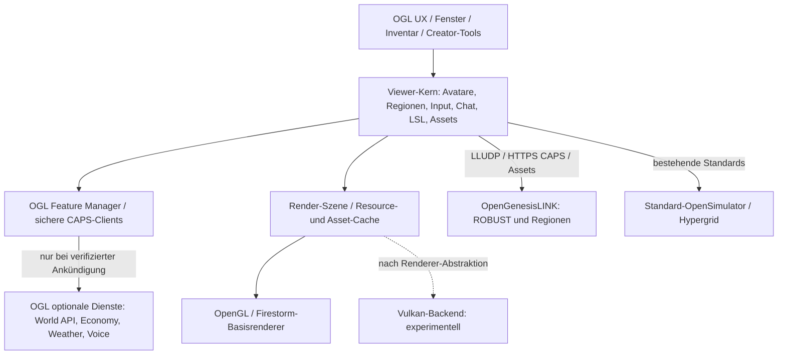

# TrixieStorm Viewer – Firestorm NextGen

**Technische Roadmap, Architektur- und Anforderungsspezifikation**  
**Stand:** 31. Oktober 2026  
**Projekt:** OpenGenesisLINK / Stadt-NexVerse  
**Viewer-Repository:** https://github.com/opengenesislink/trixiestormviewer  
**Server-Repository:** https://github.com/opengenesislink/opengenesislinkserver  
**Status dieser Datei:** Entwicklungsplanung, **keine** Behauptung bereits fertiggestellter Funktionen.

> **Grundsatz:** Ein unabhängiger, für OpenGenesisLINK optimierter Firestorm-Fork soll die volle OpenSim-/Hypergrid-Kompatibilität erhalten und schrittweise ein modernes Erscheinungsbild, eine verbesserte Bedienung und später einen optionalen NextGen-Renderer erhalten. Grafikfunktionen dürfen nicht auf Kosten von Inventar, Berechtigungen, Teleport, Voice oder Stabilität aktiviert werden.

---

## 1. Ausgangslage und verbindliche Entscheidungen

### 1.1 Verifizierter Repository-Stand und Quellcodebasis

Das eigenständige Repository `opengenesislink/trixiestormviewer` wurde am 31.10.2026 als neue Projektbasis initialisiert. Die Grundstruktur ist **kein** fertiger Viewer-Build. Firestorm-C++-Quellen sind **noch nicht importiert**, solange der Import-Branch nicht geprüft und zusammengeführt wurde. Das ursprüngliche Dokument bezog sich auf ein anderes Viewer-Repository; dessen damaliger Implementierungsstand wird für TrixieStorm nicht ungeprüft übernommen.

Vorgesehene, am 31.10.2026 gegen GitHub bestätigte Basis:

- **Upstream:** https://github.com/FirestormViewer/phoenix-firestorm
- **Quellcodebasis:** offizieller Releasebranch `Firestorm_7.2.4`, Commit `10bd3c9f930c76e1427ddd4ecece6cdf36b4406d`.
- **Erste Zielsysteme:** Windows x86_64 und Linux x86_64; OpenSim-Konfiguration `ReleaseOS`.
- **Rechte:** Upstream-Lizenz LGPL-2.1; Lizenzhinweise einzelner Dateien, Drittbibliotheken und Marken vor Veröffentlichung prüfen.
- **Branding:** offizieller Produktname, Viewer-Channel und Anwendung: **TrixieStorm Viewer**.
- **Partnertechnologie:** Powered by OpenGenesisLINK; **keine** Bindung ausschließlich an Stadt NexVerse.

Ein Versions-/Channel-String aus einem Loginlog bestätigt weder die Echtheit des Programms noch dessen Buildherkunft. Server-Allowlist, Client-Authentifizierung und die Lizenz-/Build-Provenienz sind getrennte Fragen.

### 1.2 Produktdefinition

- **Technischer Projektname:** TrixieStorm Viewer (basierend auf Firestorm; OpenGenesisLINK-Integration).
- **Verbindlicher Markenname:** TrixieStorm Viewer; Anwendungssymbol ist das vom Projekt bereitgestellte pink-violette TrixieStorm-Motiv. Der Name allein entscheidet nicht über Login-Rechte.
- **Priorität 1:** funktionsgleicher OpenSim-Viewer mit stabilem Build, Upgrade- und Rollbackfähigkeit.
- **Priorität 2:** OGL-spezifische Funktionen, ohne Verweigerung des Logins bei fremden kompatiblen Grids.
- **Priorität 3:** schnelleres und hochwertigeres Rendering mit messbarem Nutzen.
- **Keine Voraussetzung:** ein genereller Ersatz des OpenGenesisLINK-Servers, ein Wechsel seiner Datenbank oder eine neue Engine auf dem Regionssimulator.

### 1.3 Nichtziele für die ersten Versionen

- Unreal Engine oder Unity als „Plugin“ in Firestorm einbetten. Das wäre praktisch eine eigenständige Viewer-Neuentwicklung mit erheblichem Protokoll- und Funktionsportierungsaufwand.
- Vulkan, Hardware-Raytracing oder FPS-Zuwächse als bereits vorhanden bezeichnen.
- Alte Firestorm-Installationen, Benutzereinstellungen oder Caches überschreiben.
- Rechte, Wirtschaftstransaktionen oder Objektbesitz clientseitig entscheiden.
- Nicht standardisierte OGL-Funktionen auf anderen OpenSim-/Hypergrid-Grids erzwingen.

---

## 2. Zielarchitektur



**Architekturregeln**

1. Firestorms Login-, Avatar-, Inventar-, Script-, Netzwerk- und OpenSim-Protokollpfade werden möglichst **adaptiert statt kopiert**.
2. Ein *Feature Manager* schaltet Funktionen nur ein, wenn die aktuelle Grid-/Regionssitzung die passende Fähigkeit vertrauenswürdig annonciert.
3. Rendering-Backend und Weltsimulation erhalten eine klar definierte Schnittstelle; GPU-Ressourcen dürfen keine Besitz-/Berechtigungslogik enthalten.
4. Der klassische Renderer bleibt während der Vulkan-Entwicklung die funktionale Referenz und Rückfallebene.
5. Netzwerk-I/O, Inventaroperationen, Asset-Downloads und Shader-Kompilierung dürfen die Haupt-/Render-Schleife nicht unkontrolliert blockieren.
6. Web-API-Endpunkte und Tokens dürfen nur über die sichere Sitzungs-/CAP-Autorisierung genutzt werden. Der Viewer ist ein nicht vertrauenswürdiger Client.

### 2.1 Vorgeschlagene Modulgrenzen (erst nach Quellcodeimport bestätigen)

| Modul | Aufgabe | Priorität |
|---|---|---|
| `ogl/core` | Featureflags, Konfiguration, Lifecycle, Fehlerisolation | P0 |
| `ogl/network` | HTTPS, CAP-Negotiation, Versionsprüfung, Timeouts | P0 |
| `ogl/identity` | Gridbindung, Sitzungswechsel, sichere Tokenverwendung | P0 |
| `ogl/ui` | Eigenes Branding, Andockfenster, Accessibility, Themes | P1 |
| `ogl/services` | World API / Marketplace / Economy / Search | P1 |
| `ogl/weather` | Optionale Darstellung des OGLWeather-Zustands | P1 |
| `ogl/voice` | OGL Voice / LiveKit nur über ausgehandelte Serverintegration | P1 |
| `ogl/renderer` | Render-Adapter, Metriken und spätere Vulkan-R&D | P1/P2 |
| `ogl/diagnostics` | Opt-in-Diagnose und Crash-/Performanceanalyse | P0 |

Diese Pfade sind **Designvorschläge**, keine bereits existierenden Firestorm-Unterverzeichnisse.

---

## 3. Funktionale Anforderungen an den modifizierten Firestorm

### 3.1 Login, Grid-Verwaltung und Identität (P0)

- [ ] Standard-OpenSim-Login beibehalten, inklusive LLSD/XML-RPC, CAPS und Grid Manager.
- [ ] Stadt-NexVerse als auswählbare Voreinstellung bereitstellen, fremde Grids weiterhin zulassen.
- [ ] Eigenständige **Viewer-Channel-Kennung** im C++-Build nachweisbar setzen: `TrixieStorm Viewer`. Serverseitige Channel-Allowlist getrennt prüfen.
- [ ] Eine Server-Zulassungsprüfung darf anhand von `channel` und `version` nur Kompatibilitätsfilter sein: beide Strings sind durch fremde Clients fälschbar.
- [ ] Doppelte Sitzungen, ungültige Tokens, regionale Fehlermeldungen und Serverneustarts korrekt behandeln.
- [ ] Separate Benutzerprofile, Cache-, Crashlog- und Settings-Verzeichnisse für OGL und unveränderten Firestorm.
- [ ] Signierte Updatekanäle, opt-in Testbuilds und sicheres Downgrade.
- [ ] Beim Gridwechsel sämtliche OGL-spezifischen Berechtigungen, CAP-URLs und temporären Sitzungszustände verwerfen.

### 3.2 Benutzeroberfläche (P1)

- [ ] Moderne, ein-/ausblendbare Seitenbereiche; frei konfigurierbare Quickbar.
- [ ] Werkzeuge für Inventar, Freunde, Gruppen, Suche, Karte, Teleport und Bauworkflow.
- [ ] Dark-/Light-Mode, individuelle Akzentfarbe, Skalierung, Tastatursteuerung und Screenreader-relevante Beschriftungen.
- [ ] Gut sichtbare Statusleiste für FPS, Ping, Avatar-/Regionsstatus, Cache und Verbindungsqualität.
- [ ] Optional **Berliner Uhr (Europe/Berlin, MEZ/MESZ)** im eigenen OGL-UI anzeigen; nicht mit dem Legacy-Firestorm-`daylight_savings`-Flag verwechseln.
- [ ] Trennung zwischen einer inworld simulierten Sonnen-/Tageszeit und realer Berliner Uhrzeit.
- [ ] Keine kritischen Eingriffe in die gewohnten Firestorm-Bau-, Inventar- und Avatar-Funktionen ohne A/B-Test.

### 3.3 OpenGenesisLINK-Funktionen (P1; einzeln freischaltbar)

| OGL-Funktion | Viewer-Integration | Notwendige Absicherung / Fallback |
|---|---|---|
| World API | Status-/Gridinformationen und optionale Funktionen anzeigen | Nur dokumentierte, autorisierte Endpunkte; kein Raten von CAP-URLs |
| OGLWeather | Regen, Schnee, Nebel, Wolken und lokale Effekte clientseitig darstellen | Nur mit gültigem serverseitigem Wetterzustand; sonst Standard-Viewer-Verhalten |
| OGL Voice / LiveKit | Inworld-Voice in den Viewer einbinden | Sitzungsgebundene kurzlebige Tokens; andere Grids behalten ihre Voice-Fallbacks |
| NV$ Economy | Kontostand, Transaktionsdialog und Bestätigungen | Salden und Buchungen nur vom Server; kein unbestätigter lokaler Zahlungserfolg |
| Marketplace | Artikelvorschau, Web-/Inworld-Deep-Links | Besitz, Lieferung und Kosten immer serverseitig prüfen |
| OGL IAR Self-Service | Authentifizierter Import/Export mit 4-MiB-Blöcken, MD5/SHA-256, ETA | Nur eigener Avatar; große Dateien nicht komplett in den RAM lesen |
| OGL AssetService | Besseres Caching und schnellere Wiederverwendung | Keine Änderung am Asset-ID-/Berechtigungsmodell ohne Protokollvereinbarung |
| OGL Energy | Optionale Energienetz-/Wetterdisplays | Reine Anzeige; keine echten Ausfälle oder finanzielle Abrechnung im Client |
| FastRez / FastMap | Optimierte Wahrnehmung von Lade-/Sichtbarkeitszuständen | Servermodule sind nicht automatisch neue Client-Protokolle |
| Hypergrid / Federation | Besucherfreundliche Gridwechsel, Such-/Teleportoptionen | Standard-Hypergrid muss weiter funktionieren; fremde Grids nicht abwerten |

**Vertragsprinzip:** Ein vorhandener serverseitiger Endpunkt allein bedeutet **noch keine** funktionierende Viewerintegration. Je Feature sind Protokollversion, Berechtigungen, Fehlermeldungen, Rate Limits und Fallback separat zu implementieren.

---

## 4. OGL NextGen Renderer – Realisierungsweg

### R0 – Firestorm/PBR-Basis vermessen

- [ ] Quellcode und bestehende PBR-, Terrain-, Avatar-, Wasser-, UI- und Postprocessing-Pipelines dokumentieren.
- [ ] Testregionen reproduzierbar aufbauen: leere Region, Freiburg-Stadt, Gummybear Shopping, dichtes Avatar-Event, transparente Bäume, Nacht/Wasser/Wetter.
- [ ] Werte aufzeichnen: CPU-/GPU-Framezeiten (p50/p95/p99), 1%-Low-FPS, VRAM-Spitze, Shader-Stalls, Draw Calls, Textur-Latenz, Cold-/Warm-Cache und Crashrate.
- [ ] Hardware-Klassen: integrierte GPU, Mittelklasse-GPU, moderne High-End-GPU; Linux und Windows mit konkreten Treiberversionen.
- [ ] Messwertarchiv pro Commit und deterministische Grafik-Einstellungen.

**Exit-Gate:** Reproduzierbare Ausgangswerte; ohne diese keine belastbaren „schneller“-Aussagen.

### R1 – Bestehenden Renderer optimieren (erste echte Grafikverbesserungen)

- [ ] Sichtbarkeitsberechnung / Frustum- und Occlusion-Culling prüfen.
- [ ] Textur-Streaming, GPU-Uploads, Cache-Invalidierung und Mesh-LOD-Übergänge verbessern.
- [ ] Materialwechsel/Draw Calls reduzieren, Ressourcenfreigabe und Render-Thread-Koordination messen.
- [ ] PBR-Materialien, Normal Maps, Schattenqualität, Umgebungsbeleuchtung, Tonemapping, Anti-Aliasing und Wasser schrittweise optimieren.
- [ ] Neue Grafikoptionen hinter Featureflags; sofort rückschaltbar.

**Exit-Gate:** Bildparität oder klar dokumentierte Verbesserung; keine Inventar-, Avatar-, Alpha-, UI- oder Regionswechselregressionen.

### R2 – Renderer-Schnittstellen entkoppeln

Vorgeschlagene Abstraktionen nach Quellcodeprüfung:

```text
RenderDevice
  ├─ OpenGLBackend  (Referenz / Fallback)
  └─ VulkanBackend  (zunächst experimentell)
RenderGraph / RenderPass
TextureResource / BufferResource / Sampler
ShaderPipeline / MaterialSystem
Swapchain / RenderTarget
GpuProfiler / FrameMetrics
```

- [ ] Asset- und Szenedaten von API-spezifischen GL-Handles trennen.
- [ ] Für Shader, Texturen, Buffer, Synchronisierung und Frame-Lifetime explizite Verträge festlegen.
- [ ] UI-Compositing, Web-/Videotexturen, transparente Geometrie, HUDs, Partikel, Avatar-Skinning und PBR in der Abstraktion berücksichtigen.
- [ ] Erst nach OpenGL-Parität das Vulkan-Backend zum Produktkandidaten machen.

### R3 – Vulkan als alternatives Backend (Forschung → Preview)

- [ ] Vulkan-Prototyp zeichnet Terrain, statische Meshes und Kamera einer OpenSim-Testregion.
- [ ] Danach Texturen, PBR, Avatare/Skinned Meshes, Schatten, Alphablending, Partikel, HUD und UI schrittweise portieren.
- [ ] Ressourcen-/Pipeline-Caches, Descriptor-Verwaltung und GPU-Synchronisierung stabilisieren.
- [ ] Treiber- und Plattformtest; bei inkompatibler GPU oder Vulkan-Initialisierungsfehler auf OpenGL zurückfallen.
- [ ] Backend-Wahl in den Einstellungen mit Neustart-Hinweis und Crash-Fallback.

**Nicht in R3 behaupten:** Vulkan macht eine Region nicht automatisch schöner oder schneller. Ein Backend-Wechsel allein ergänzt keine besseren Meshes, Shader oder Weltinformationen.

### R4 – Hochwertigere Inworld-Grafik (optional)

| Effekt | Voraussetzungen | Erwartete Schwierigkeit |
|---|---|---|
| Verbesserte Sonnenschatten, Kontakt-Schatten, Ambient Occlusion | Shader- und Renderpass-Arbeit | mittel |
| Realistisches Wasser mit Reflexion/Transparenz | Wasserpass, Reflexion, Materialdaten | mittel–hoch |
| Volumetrischer Nebel und Lichtstrahlen | Kamera-/Wetterdaten, Volumenrendering | hoch |
| Regen/Schnee mit PBR-Beleuchtung | OGLWeather-Zustand oder lokale sichere Simulation | mittel–hoch |
| Screen-Space-Reflexion / TAA / Upscaling | Motion Vectors, Reprojection, Quality-Gates | hoch |
| Dynamische indirekte Beleuchtung | GI-Technik, Performancebudget | sehr hoch |
| Hardware-Raytracing | Vulkan-RT-fähige GPU/Driver, Acceleration Structures | sehr hoch |

**Qualitätsstufen:** Standard (OpenGL), High (verbesserter PBR-Pfad), Ultra (nur geeignete Hardware; Vulkan/RT optional). Das sind **geplante Produktprofile**, keine bereits unterstützten Modi.

### R5 – Technische Abnahmekriterien für Grafik

- [ ] Bei gleichen Einstellungen, Auflösung, Szene und Treiberversion A/B-Messung gegen den gepinnten Firestorm-Baselinebuild.
- [ ] Keine Blocker bei UI, Texturen, Alphasortierung, Skinned Avatars, PBR, Bauwerkzeugen oder Hypergrid-Regionwechsel.
- [ ] Crashfreiheit über längere Sessions; Grafik-Reset und Recovery nach Device-Loss oder Treiberfehler.
- [ ] Vor dem Test messbare Budgets vereinbaren (Beispiele, **noch nicht beschlossen**: p95-Framezeit nicht schlechter als +10 %, VRAM nicht schlechter als +15 % gegenüber Baseline bei vergleichbarer Qualität).
- [ ] Optionales RT darf auf nicht unterstützter Hardware weder Login noch Rendering verhindern.

---

## 5. Build- und Entwicklungsstrategie

### Schritt A – Originalquellen importieren (P0)

```bash
git clone https://github.com/opengenesislink/trixiestormviewer.git
cd trixiestormviewer
bash scripts/import_firestorm.sh
# Danach Konflikte, Attribution und Buildänderungen im Feature-Branch prüfen;
# anschließend Review/PR nach main, nie Force-Push.
```

Der Helper prüft den sauberen Arbeitsbaum, holt den exakt gepinnten offiziellen Firestorm-Releasebranch und versucht einen Merge mit erhaltener Upstream-Historie auf `feature/firestorm-source-import`. Wenn Konflikte auftreten, endet er **ohne** sie stillschweigend zu überschreiben. Vor Merge sind die Quellenlizenzen und Abhängigkeiten zu prüfen. Erst nach Review und erfolgreichen `ReleaseOS`-Builds zählt M1 als abgeschlossen.

### Schritt B – Funktionierende OpenSimulator-Builds (P0)

- **Linux x64:** offizielle Toolchain des gepinnten Firestorm-Releases und `ReleaseOS`.
- **Windows x64:** passende Visual-Studio-/Autobuild-Toolchain und `ReleaseOS`.
- Anschließend einen **realen Viewer-Build** mit SHA, Dependency-Lock, Compiler-Version, OS, Build-Log und Prüfsumme archivieren.
- Test gegen Stadt-NexVerse **und** mindestens ein unverändertes OpenSimulator-Testgrid.
- Optional weitere Zielplattformen (z. B. Linux ARM64, macOS) erst nach Nachweis der Abhängigkeiten und CI-Kapazität.

**Abhängigkeit:** Eine grüne Foundation-CI ist *kein* Beweis für einen erfolgreichen C++-Viewer-Build.

### Schritt C – Eigene Anwendung und Distribution (P0/P1)

- Eigene ausführbare Dateinamen, App-/Bundle-IDs, Ordner und Signaturen.
- Keine Überschreibung der offiziellen Firestorm-Konfiguration oder Cacheverzeichnisse.
- Lizenz- und Attributionstexte über ein eigenes „Über/Lizenzen“-Menü erreichbar.
- Separater Development-/Beta-/Stable-Kanal mit Update- und Rollbacktests.
- Loggt keine Anmeldedaten oder kompletten CAP-/OAuth-Tokens.
- Telemetrie nur transparent und mit passender Rechtsgrundlage/Einwilligung.

---

## 6. Geordnete Roadmap mit Definition of Done

| Phase | Priorität | Inhalt | Abnahme / Definition of Done | Status TrixieStorm Viewer |
|---|---|---|---|---|
| M0 | P0 | Architektur, Lizenzgrundlage, Importstrategie | Dokumente/CI + rechtliche Prüfung | Grundstruktur angelegt; rechtliches Audit offen |
| M1 | P0 | Firestorm-Quellcodeimport und `ReleaseOS` | Linux/Windows x64 starten, Gridlogin, HG/Inventar/Teleport | Nicht nachgewiesen |
| M2 | P0 | Branding, Installation, eigener Cache/Updater | Firestorm parallel ohne Konflikte, Rollback | Nicht nachgewiesen |
| M3 | P1 | OGL CAP/World API, Voice, NV$, Marketplace | Authentifizierte Funktionen, Standard-Grid-Fallback | Nicht nachgewiesen |
| M4 | P1 | Moderne Oberfläche und Bedienung | Build-, Inventar- und Avatar-Regressionen | Nicht nachgewiesen |
| M5-R0/R1 | P1 | Profiling, Optimierung vorhandener PBR-Engine | Vergleichsmessungen, stabile Renderqualität | Nicht nachgewiesen |
| M5-R2/R3 | P2 | API-Abstraktion und Vulkan-Prototyp | Vulkan-Parität und OpenGL-Fallback | Forschung, nicht nachgewiesen |
| M5-R4 | P2 | Wetter, Wasser, Upscaling, RT-Effekte | Hardwareprofil, opt-in, Performance- und Bildtests | Forschung, nicht nachgewiesen |
| M6 | P2 | Hydro-/Terrain-/Federation-Erweiterungen | Sichere Protokolle und unveränderte Fremdgrids | Nicht nachgewiesen |
| M7 | P0 | Signed Releases, Privacy, SBOM, Testmatrix | Vollständige Produktabnahme | Nicht nachgewiesen |

**Abhängigkeitsfolge:** `M0 → M1 → M2 → M3/M4 → M5 → M6 → M7`. Rendererforschung kann parallel ab M1 beginnen, ohne den eigentlichen Releasepfad aufzuhalten.

### 6.1 Erste konkrete Arbeitspakete

1. **VIEW-001:** Firestorm-Upstream importieren, Pin/Provenienz und Dependency-Audit.
2. **VIEW-002:** Linux/Windows-x64-`ReleaseOS`-CI mit installierbaren Artefakten.
3. **VIEW-003:** OpenGenesisLINK-Login, Hypergrid, Inventar, Voice und Teleport baseline testen.
4. **VIEW-004:** Eigenes Branding und voneinander unabhängige Profile/Updatekanäle.
5. **VIEW-005:** OGL-CAP-Manager mit Gridwechsel-Cleanup, Timeouts und negativen Authentifizierungstests.
6. **VIEW-006:** Modernes UI mit andockbaren Seitenleisten und Berliner Uhr.
7. **VIEW-007:** GPU-Profiling und repräsentative Stadt-NexVerse-Testszenen.
8. **VIEW-008:** Render-Resource-Grenzen definieren und OpenGL-Regression absichern.
9. **VIEW-009:** Experimentellen Vulkan-Backend-Prototyp mit Fallback implementieren.
10. **VIEW-010:** Volumetrisches Wetter, Wasser und optionale neue Lichtverfahren evaluieren.
11. **VIEW-011:** Installer, Signaturen, Update-/Rollbacktest, Lizenzen und Datenschutz.
12. **VIEW-012:** Beta-Abnahme auf echter Hardware und Standard-OpenSim-Grids.

Jedes Arbeitspaket benötigt eine eigene Issue/PR mit reproduzierbaren Tests, Dokumentation und einem abschaltbaren Migrationspfad. Vorhandene GitHub-Issues im Viewer-Repo prüfen, bevor Duplikate angelegt werden.

---

## 7. Technische Testmatrix

| Szenario | Muss funktionieren | Zusatzprüfung |
|---|---|---|
| Stadt-NexVerse Startregion | Login, Inventar, Outfit, Kamera | Versions-/Channel-Kennung, eigenes UI |
| Freiburg Innenstadt | Mesh/PBR, Texturauflösung, Performance | Schatten, Nacht, LOD, Streaming |
| Gummybear Island / Shopping | Zahlreiche Produkte, Alpha, Anklicken | Texturen, Marketplace-Deep-Links |
| Hamburg / Veranstaltung | Viele Avatare, Attachments, Animationen | Frame-Pacing, VRAM, Voice |
| OGLWeather-Szenen | Regen, Schnee, Nebel, Tageszeiten | Grafikqualität und OpenGL-Fallback |
| Beliebiger Standard-OpenSim-Grid | Login, HG, Inventar, Teleport | **Keine** OGL-Funktion erforderlich |
| Variable Region / Grenzübergang | Kamera, Bewegung, Szene | Ressourcenfreigabe/Prefetch |
| Verbindungsverlust / Tokenablauf | Sichere Fehlermeldung, Wiederaufnahme | Kein Cache- oder Tokenleck |
| Vulkan nicht verfügbar | Viewer startet weiterhin | Automatischer OpenGL-Fallback |
| Parallelinstallation | Offizieller Firestorm unberührt | Profile, Updates, Deinstallation |

**Freigabeanforderungen:** Erfolgreicher Build ≠ erfolgreicher Inworld-Test. Jede wesentliche Grafikänderung benötigt Screenshotvergleich und reproduzierbare Messwerte auf mindestens drei Hardwareklassen; Sicherheitsänderungen zusätzlich negative Tests.

---

## 8. Sicherheit, Recht und Betrieb

- Der Viewer ist kein vertrauenswürdiger Server: Kontostand, Kauf, Zahlung, Rechte, Inventartransfer, Avatar-/Objektbesitz und Asset-Export werden serverseitig entschieden.
- Viewer-Name und Versionsstring lassen sich spoofen. Eine Allowlist kann Kompatibilität steuern, aber weder echten Client noch Benutzer beweisen.
- HTTPS-Zertifikatsprüfung niemals deaktivieren; keine CAP- oder Bearer-Tokens in Logs, URLs oder Crashberichte schreiben.
- HTTP-/Web-Downloads auf Größe, Zeitlimit, Content-Type, Redirects, Domainvertrauen und sichere Dateinamen prüfen.
- Aktualisierungen signieren und reproduzierbar erzeugen; Abhängigkeiten mit SBOM und Sicherheitsprüfung dokumentieren.
- Firestorm-/Second-Life-Attribution und LGPL-Lizenzbedingungen beachten; je Datei und Binärbibliothek weitere Lizenzverpflichtungen prüfen.
- Eigenes Logo, Icon und Branding; offizielle Firestorm- oder Second-Life-Markenzeichen nicht irreführend übernehmen.
- Keine versteckte Datenerhebung oder erzwungene Kommunikation mit Drittservices.
- OpenGL-Fallback beibehalten; GPU-spezifische Effekte nicht zu einer Mindestvoraussetzung für Standard-OpenSim machen.

---

## 9. Risiken und Entscheidungen

| Risiko | Auswirkung | Maßnahme |
|---|---|---|
| Der Firestorm-Quellcode ist noch nicht im Viewer-Repo | Kein ausführbarer Ausgangsbuild | M1 vor Featureentwicklung abschließen |
| Vulkan-Portierung ist deutlich aufwendiger als Shaderoptimierung | Hohe Kosten und Grafikregressionen | Erst R1, dann R2; getrenntes Forschungsfeature |
| Neue PBR-/Wetter-Features fehlen auf anderen Grids | Fehlerhafte Optik oder Abstürze | Feature-Negotiation und Standard-Fallback |
| Server-/Viewer-Protokolle driften | Login-/Inventar-/Voice-Probleme | Versionierte Verträge und Staging-Matrix |
| Unterschiedliche GPU-Treiber | Instabilität/Renderfehler | Treibermatrix, Crash-Fallback, Featureflags |
| Lizenzpflichten bei Drittbibliotheken | Verteilungsrisiko | Vor Build/Release juristisch und technisch auditieren |
| Import überschreibt bestehende Projektgeschichte | Datenverlust im Repo | Import-Helper und Review-Branch, kein Force-Push |
| OGL-Funktionen an externen Grids | Interoperabilität leidet | OGL optional, Standard-OpenSim-Pfade erhalten |

Offene Produktentscheidungen vor M2: endgültiger Viewer-Name, Icon, Installerbezeichnung, Telemetriepolitik, Supportkanal und offizieller Updatehost. Vor R3 zusätzlich: Vulkan-GPU-Minimum, Shader-/SDK-Lizenzen und automatische Fallbackpolitik.

---

## 10. Definition „fertig“ und empfohlene nächste Reihenfolge

Ein modifizierter Firestorm-Viewer ist **erst dann** als einsatzbereit zu bezeichnen, wenn ein aus einem dokumentierten Commit reproduzierbar erzeugter Windows-/Linux-Build existiert und die Testmatrix gegen echte OpenSim- und OpenGenesisLINK-Regionen bestanden wurde. Ein CI-Erfolg für reine Markdown-/Shell-Prüfungen oder eine Serverlogmeldung mit einem Viewer-Channel reichen dafür nicht aus.

**Empfohlene Reihenfolge:**

1. Quellcodeimport und Lizenzprüfung (`M1`).
2. Reproduzierbare OpenSim-Viewer-Builds und reale Login-/Inventar-/Hypergrid-Tests.
3. Eigenständige Anwendung mit getrennten Datenverzeichnissen und Updates (`M2`).
4. Neue Oberfläche und sichere OGL-Serviceadapter (`M3/M4`).
5. Optimierter Firestorm-PBR-/OpenGL-Pfad mit dokumentierten Performancegewinnen (`R0/R1`).
6. Erst danach Vulkan-Backend, Wetter-/Wasser-Erweiterungen und optionales Raytracing (`R2–R4`).
7. Hardwareabnahme, Signierung, Release und Rollback (`M7`).

---

## 11. Referenzen und Projektdateien

- TrixieStorm Viewer: https://github.com/opengenesislink/trixiestormviewer
- Projektstatus: [docs/PROJECT_STATUS.md](docs/PROJECT_STATUS.md)
- Build/Import: [docs/BUILD.md](docs/BUILD.md)
- Lizenz-/Abhängigkeitsprüfung: [docs/LEGAL.md](docs/LEGAL.md)
- Branding und Icons: [docs/BRANDING.md](docs/BRANDING.md)
- Original-Firestorm: https://github.com/FirestormViewer/phoenix-firestorm
- Firestorm-Linux-Buildanleitung: https://github.com/FirestormViewer/phoenix-firestorm/blob/Firestorm_7.2.4/doc/building_linux.md
- Firestorm-Windows-Buildanleitung: https://github.com/FirestormViewer/phoenix-firestorm/blob/Firestorm_7.2.4/doc/building_windows.md
- OpenGenesisLINK-Server: https://github.com/opengenesislink/opengenesislinkserver

**Dokumenttyp:** Entwicklungsplanung, keine Erklärung abgeschlossener Funktionen. Fortschritt nur nach nachweisbaren Commits, Build-Artefakten und Tests aktualisieren.
